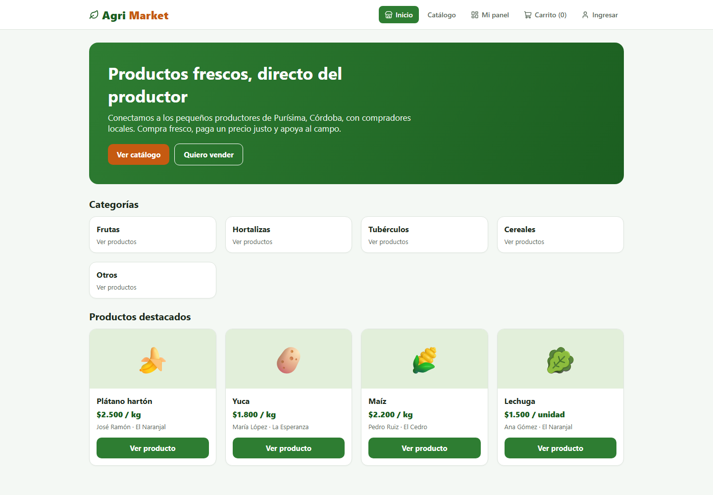

# AgriMarket


Prototipo funcional de una plataforma web para la **comercialización directa de productos agrícolas** en Purísima, Córdoba (Colombia). Conecta a pequeños productores con compradores locales para reducir la intermediación y mejorar el precio que recibe el campesino.



## Contenido

- **Prototipo funcional** del producto mínimo viable (MVP): registro, perfil del productor, publicación de productos, catálogo, búsqueda, detalle y solicitudes de compra.
- Documentos del proyecto (formulación y construcción del prototipo) en `docs/`.
- Capturas de pantalla en `capturas/`.
- Diagramas (EDT, cronograma, matriz de riesgos y mapa) en `diagramas/`.

## Demo sin instalar nada

Abre `demo.html` en el navegador (Edge o Chrome). Es una versión compilada de un solo archivo.

## Tecnologías

- **React 18** con componentes, hooks y Context API.
- **React Router** (HashRouter, funciona también como archivo local).
- **Vite** para desarrollo y compilación.
- **lucide-react** para iconografía.
- **CSS3** responsivo.
- **localStorage** para simular la persistencia.
- **ESLint + Prettier** para calidad y estilo de código.
- **Vitest + Testing Library** para pruebas automatizadas.

## Estructura

```
src/
├── main.jsx            Punto de entrada (router + providers)
├── App.jsx             Rutas de la aplicación
├── styles.css
├── components/         Header, ProductCard
├── pages/              Inicio, Login, Registro, Catalogo, Detalle,
│                       Solicitud, Exito, Panel, Publicar
├── context/            StoreContext (estado), ToastContext (notificaciones)
└── data/               seed.js (datos de ejemplo), storage.js
```

## Puesta en marcha

Requisitos: Node.js 18 o superior.

```bash
npm install
npm run dev
```

Abre la URL que indica la terminal (por defecto http://localhost:5173).

## Scripts

| Comando | Descripción |
| --- | --- |
| `npm run dev` | Servidor de desarrollo |
| `npm run build` | Compila a `dist/` (un solo archivo) |
| `npm run preview` | Previsualiza la compilación |
| `npm run lint` | Análisis estático con ESLint |
| `npm run format` | Formatea con Prettier |
| `npm test` | Ejecuta las pruebas |
| `npm run test:watch` | Pruebas en modo interactivo |

## Rutas

| Ruta | Vista |
| --- | --- |
| `/` | Inicio |
| `/login` | Ingreso |
| `/registro` | Registro |
| `/catalogo` | Catálogo |
| `/producto/:id` | Detalle del producto |
| `/solicitud` | Solicitud de compra |
| `/exito` | Confirmación |
| `/panel` | Panel del productor |
| `/publicar` | Publicar producto |

## Flujos

- **Consumidor:** inicio → catálogo → detalle → agregar a la solicitud → confirmar.
- **Productor:** panel → publicar producto → ver productos y solicitudes recibidas.

## Pruebas

```bash
npm test
```

Incluye pruebas de utilidades (formato de moneda y almacenamiento) y de renderizado del catálogo.

## Integración continua

El repositorio incluye `.github/workflows/ci.yml`, que ejecuta lint, pruebas y build en cada push y pull request.

## Despliegue

- **Netlify:** usa `netlify.toml` (build `npm run build`, publica `dist`).
- **Vercel:** usa `vercel.json`.
- **GitHub Pages:** publica el contenido de `dist/` (la app usa HashRouter, por lo que no requiere configuración de rutas).

## Equipo

- Antonio José Barrios Reyes
- Cristian Santiago Hernández García

Facultad de Ingeniería - Programa de Ingeniería de Software
Corporación Universitaria Iberoamericana
Docente: Ana Mosquera
2026

## Licencia

MIT. Ver [LICENSE](LICENSE).
